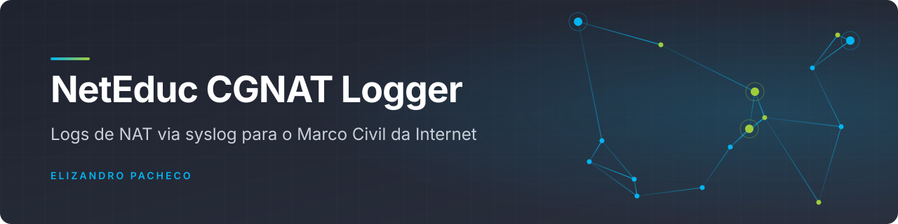

<div align="center">



<br>

**Daemon para provedores que recebe os logs de NAT (CGNAT) do roteador por syslog e os guarda compactados, hora a hora, para cumprir as obrigações de guarda do Marco Civil da Internet.**

[](LICENSE)
[](https://github.com/elizandropacheco/neteducgnatloggerd)
[](https://github.com/elizandropacheco/neteducgnatloggerd/commits)
[](https://github.com/elizandropacheco/neteducgnatloggerd/stargazers)


[Sobre](#sobre) · [Uso](#uso) · [Licença](#licença)

</div>

---

> [!WARNING]
> Projeto legado, publicado em 2017. Os executáveis foram compilados para Linux x86-64 com Python 2.7, que
> não recebe mais atualizações desde 2020. Avalie o uso em produção com cuidado.

## Sobre

O **Network Education CGNAT Logger** (`neteducgnatd`) é um daemon de logs de NAT que respeita as obrigações do
Marco Civil da Internet. Ele escuta **syslog via UDP** na porta configurada, grava as mensagens do roteador em
uma pasta de armazenamento e gera **um arquivo compactado em bz2 por hora** (nome no formato
`DD-MM-AAAA-HH.bz2`).

O daemon é licenciado por equipamento: o `geraserial` lê o serial da placa-mãe do servidor (via `dmidecode`)
e a **Network Education** devolve a licença correspondente. Sem ela, o daemon informa que o sistema não está
licenciado para o dispositivo.

### Recursos

- Compatível com RouterOS (MikroTik).
- Pasta de armazenamento configurável.
- Compatível com armazenamento na nuvem (MEGA, Drive, Dropbox).
- Compactação bz2 automática.
- Rotação automática de hora em hora.

### Consumo de recursos

Medição original do projeto:

- aprox. 400 MB;
- 7% de CPU de um núcleo de 2,8 GHz;
- 8 a 10 MB por arquivo por hora.

### Conteúdo do repositório

| Arquivo | Função |
|---|---|
| `neteducgnatd` | daemon de logs (executável Linux x86-64) |
| `geraserial` | gera o serial do servidor para o pedido de licença (executável Linux x86-64) |
| `start` | script de inicialização com a pasta de logs e a porta |

## Uso

> [!NOTE]
> Recomendamos uma instalação limpa do **Ubuntu Server 64 bits**. Todos os comandos devem ser executados como
> root ou com `sudo`.

### 1. Dependências

```bash
apt-get install python-pip git
pip install pathlib
```

### 2. Instalação

```bash
cd /
git clone https://github.com/elizandropacheco/neteducgnatloggerd.git neteducgnatloggerd
cd neteducgnatloggerd
./geraserial
```

Envie o serial gerado para a Network Education (caso você tenha adquirido a licença). A Network Education
devolve a licença e as instruções de exportação do roteador; então crie o arquivo de licença:

```bash
touch /etc/<LICENÇA>
```

### 3. Configuração e execução

Edite as variáveis do arquivo `start` (porta e local de armazenamento). Por padrão, ele usa a pasta
`/neteducgnatloggerd/logs` e a porta `666`:

```sh
PASTA="/neteducgnatloggerd/logs"
PORTA="666"
```

Depois, inicie o daemon em uma sessão `screen` destacada:

```bash
vim start
screen -m -d sh start
```

### Comandos auxiliares

Para acompanhar o software em tempo real:

```bash
screen -r
```

Para sair sem encerrar o daemon, pressione `Ctrl+A`, digite `:detach` e pressione `Enter`.

## Agradecimentos

- **Uesley Correa**: desenvolvedor e motivador do projeto (e quem pagou a cerveja).
- **Guilherme Ramires**: contribuições em firewall e lógica de captura.

## Licença

Distribuído sob a licença **MIT**. © 2017-2026 Elizandro Pacheco. Veja [LICENSE](LICENSE).

## Autor

<table>
  <tr>
    <td align="center">
      <a href="https://github.com/elizandropacheco">
        <br>
        <sub><b>Elizandro Pacheco</b></sub>
      </a><br>
      <sub>Desenvolvedor e autor do projeto</sub>
    </td>
  </tr>
</table>

[](https://elizandropacheco.io)
[](https://www.linkedin.com/in/elizandropacheco)
[](https://github.com/elizandropacheco)
[](https://www.youtube.com/@ElizandroPacheco)
[](https://www.instagram.com/elizandropacheco)

<div align="center">
<sub>Feito por <a href="https://github.com/elizandropacheco">Elizandro Pacheco</a></sub>
</div>
